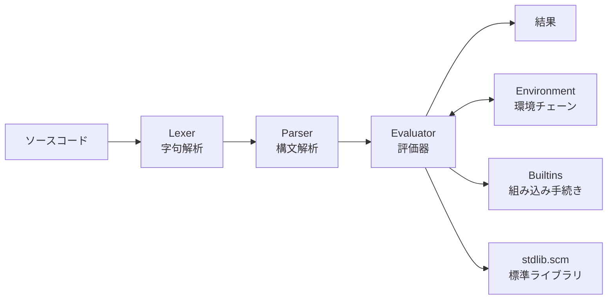

# sucheme-rust

RustでR5RS準拠のSchemeインタープリターを実装したプロジェクトです。GitHub Copilotと協力して開発されました。

[](https://github.com/suchi/sucheme-rust/actions/workflows/ci.yml)

## 特徴

- **R5RS準拠** — 付録マクロを含むR5RS仕様を完全実装
- **末尾呼び出し最適化** — トランポリンループによる適切な末尾呼び出し（スタックオーバーフローなし）
- **インタラクティブREPL** — Emacsキーバインドとコマンド履歴（rustyline使用）
- **LLVM 17 JIT バックエンド** — `--features llvm-backend` で整数演算をネイティブコードに JIT コンパイル
- **Web UI** — 内蔵HTTPサーバーによるブラウザREPL
- **Schemeで実装した標準ライブラリ** — R5RS付録マクロとユーティリティ
- **豊富なCLIオプション** — `--eval`、`--load`、`--script`、`--interactive`、`--jit` など

## クイックスタート

```bash
# ビルド
cargo build --release

# インタラクティブREPL
./target/release/sucheme-rust

# 式の評価
./target/release/sucheme-rust -e "(+ 1 2 3)"

# Schemeファイルの実行
./target/release/sucheme-rust myfile.scm

# ファイルを読み込んでからREPL
./target/release/sucheme-rust -l lib.scm -i

# Webサーバー起動 (http://localhost:8080)
./target/release/sucheme-rust --web
```

## CLIオプション

```
Usage: sucheme-rust [OPTIONS] [FILE [ARGS...]]

オプション:
  -h, --help           ヘルプを表示
  -v, --version        バージョンを表示
  -e, --eval EXPR      式を評価（複数指定可）
  -l, --load FILE      REPL/スクリプト実行前にファイルをロード
  -i, --interactive    -e やファイル実行後もREPLを続行
  -q, --quiet          起動バナーを抑制
  -n, --no-stdlib      標準ライブラリをロードしない
      --script FILE    スクリプトとしてファイルを実行
  -w, --web            Webサーバー起動
  -p, --port PORT      ポート番号（デフォルト: 8080）
      --               以降の引数をスクリプトに渡す (*argv*)

LLVM JITオプション (--features llvm-backend でビルド時のみ):
      --jit            LLVM JIT で整数演算式をコンパイル実行
      --emit-llvm      LLVM IR を出力（評価なし）
```

## LLVM JIT バックエンド

`llvm-backend` feature を有効にすると、整数演算式を LLVM 17 でネイティブコードに JIT コンパイルして実行できます。

```bash
# LLVM 17 dev ヘッダーのインストール
sudo apt-get install llvm-17-dev libpolly-17-dev

# LLVM JIT バックエンド付きビルド
cargo build --features llvm-backend

# JIT モードで実行（インタープリターへの透過的フォールバック付き）
./target/debug/sucheme-rust --jit -e "(let ((n 1000)) (* n n))"
# → 1000000

# 生成される LLVM IR の確認（LLVM が定数式を最適化する様子も確認可能）
./target/debug/sucheme-rust --emit-llvm -e "(+ 1 2 3)"
# → define i64 @__entry() { entry: ret i64 6 }
#   ← LLVM が (+ 1 2 3) を ret i64 6 に定数畳み込み！

# SCHEME_DUMP_IR=1 でデバッグ出力
SCHEME_DUMP_IR=1 ./target/debug/sucheme-rust --jit -e "(if (> 10 5) 42 0)"
```

### JIT 対応サブセット

| カテゴリ | 対応する式 |
|---------|-----------|
| リテラル | 整数、ブール値 |
| 算術 | `+`, `-`, `*`, `quotient`, `remainder` |
| 比較 | `=`, `<`, `>`, `<=`, `>=` |
| 論理 | `not` |
| 制御 | `if`, `begin` |
| バインディング | `let`, `let*` |

上記以外の式（文字列操作、リスト操作、入出力など）は透過的にインタープリターにフォールバックします。

## アーキテクチャ



## プロジェクト構成

```
src/
  main.rs      - エントリポイントとCLI
  types.rs     - Scheme値型（Val、Env、Proc）
  lexer.rs     - 字句解析器
  parser.rs    - S式パーサー
  eval.rs      - 評価器（末尾呼び出し最適化付き）
  builtins.rs  - 組み込み手続き
  repl.rs      - インタラクティブREPL
  web.rs       - Webサーバー
scheme/
  stdlib.scm   - Schemeで実装した標準ライブラリ
web/static/
  index.html   - Web REPL UI
examples/      - サンプルプログラム（章別）
docs/          - ドキュメント（SOW、ADR、チュートリアル）
```

## ドキュメント

| ドキュメント | 内容 |
|------------|------|
| [SOW](docs/SOW.md) | 作業範囲定義書 |
| [オンボーディングガイド](docs/ONBOARDING.md) | 開発者向け入門ガイド |
| [R5RS対応状況](docs/R5RS-COMPLIANCE.md) | R5RS関数・マクロの対応表 |
| [チュートリアル](docs/TUTORIAL.md) | 100以上のサンプルで学ぶScheme |
| [ADR-001](docs/adr/ADR-001-language-choice.md) | 言語選択の理由 |
| [ADR-002](docs/adr/ADR-002-tco-trampoline.md) | TCO戦略 |
| [ADR-003](docs/adr/ADR-003-stdlib-in-scheme.md) | 標準ライブラリをSchemeで実装 |
| [ADR-004](docs/adr/ADR-004-web-ui-actix.md) | Web UIフレームワーク選択 |

## サンプルの実行

```bash
# 基礎
cargo run -- examples/01-basics.scm
# 変数と定義
cargo run -- examples/02-variables.scm
# 関数
cargo run -- examples/03-functions.scm
# 全サンプルを一覧表示
ls examples/
```

## ライセンス

MIT

