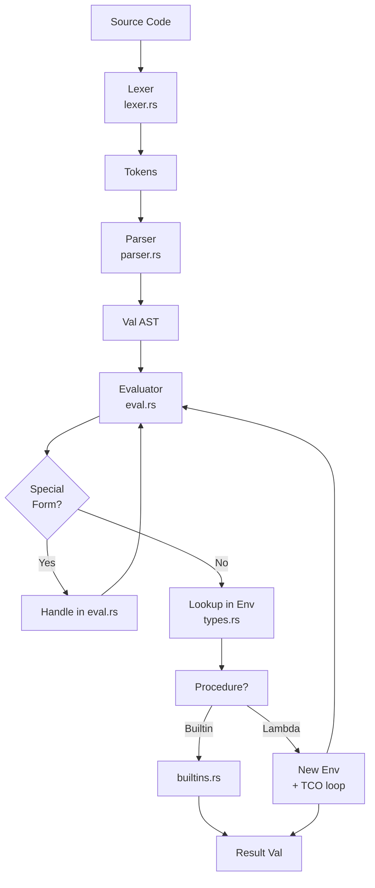

# cprustscheme Onboarding Guide

Welcome to **cprustscheme** – an R5RS-compatible Scheme interpreter written in Rust.

## Table of Contents

1. [Prerequisites](#prerequisites)
2. [Build & Run](#build--run)
3. [Project Structure](#project-structure)
4. [Architecture Overview](#architecture-overview)
5. [Development Workflow](#development-workflow)
6. [Testing](#testing)
7. [Adding New Builtins](#adding-new-builtins)
8. [Web UI](#web-ui)
9. [CI/CD](#cicd)

---

## Prerequisites

| Tool | Version | Install |
|------|---------|---------|
| Rust | 1.70+ (stable) | https://rustup.rs |
| Git  | any | system |

```bash
# Verify installations
rustc --version   # rustc 1.70.0 or later
cargo --version
```

---

## Build & Run

```bash
# Clone
git clone https://github.com/suchi/cprustscheme.git
cd cprustscheme

# Build (debug)
cargo build

# Run tests
cargo test

# Start interactive REPL
cargo run

# Evaluate a file
cargo run -- myfile.scm

# Evaluate an expression
cargo run -- -e "(+ 1 2)"

# Start web server (default port 8080)
cargo run -- --web

# Build release binary
cargo build --release
./target/release/cprustscheme
```

---

## Project Structure

```
cprustscheme/
├── src/
│   ├── main.rs          # Entry point, CLI argument parsing
│   ├── types.rs         # Val, Env, Proc, SchemeError types
│   ├── lexer.rs         # Tokenizer (source → tokens)
│   ├── parser.rs        # Parser (tokens → Val AST)
│   ├── eval.rs          # Evaluator with TCO (trampoline loop)
│   ├── builtins.rs      # Built-in procedures (R5RS)
│   ├── repl.rs          # Interactive REPL (rustyline)
│   └── web.rs           # Web server (actix-web)
├── scheme/
│   └── stdlib.scm       # Standard library in Scheme
├── web/
│   └── static/
│       └── index.html   # Web REPL UI
├── docs/
│   ├── SOW.md           # Statement of Work
│   ├── ONBOARDING.md    # This file
│   └── adr/             # Architecture Decision Records
│       ├── ADR-001-language-choice.md
│       ├── ADR-002-tco-trampoline.md
│       ├── ADR-003-stdlib-in-scheme.md
│       └── ADR-004-web-ui-actix.md
├── .github/
│   └── workflows/
│       ├── ci.yml       # CI: build, test, lint
│       └── release.yml  # Release: tag → GitHub Release
├── Cargo.toml
├── .editorconfig
└── README.md
```

---

## Architecture Overview



### Evaluation Pipeline

1. **Lexer** (`lexer.rs`): Source string → `Vec<Token>`
2. **Parser** (`parser.rs`): `Vec<Token>` → `Vec<Val>` (S-expression AST)
3. **Evaluator** (`eval.rs`): `Val` + `Env` → `Val`
   - Special forms handled directly in the `eval()` trampoline loop
   - Procedure calls: args evaluated, then `bind_params()` + body evaluated
   - TCO: tail positions set `expr` and `env`, then `continue`

### Value Types (`types.rs`)

```rust
enum Val {
    Int(i64),          // exact integer
    Float(f64),        // inexact float
    Bool(bool),        // #t, #f
    Char(char),        // #\a, #\space
    Str(Rc<RefCell<String>>),     // mutable string
    Symbol(Rc<str>),              // interned symbol
    Pair(Rc<RefCell<(Val, Val)>>),// cons cell (mutable)
    Nil,                          // ()
    Vector(Rc<RefCell<Vec<Val>>>),// mutable vector
    Proc(Proc),                   // procedure
    Port(Port),                   // I/O port
    Void,                         // unspecified
    Eof,                          // end-of-file
}
```

### Environment Chain

```
Global Env
   ↑
Lambda Env (closure capture)
   ↑
Call Env (parameter bindings)
```

Each `Env` is `Rc<RefCell<Env>>` for shared mutable access.

---

## Development Workflow

```bash
# Create a feature branch
git checkout -b feature/my-feature

# Develop and test
cargo test
cargo clippy
cargo fmt

# Commit and push
git add .
git commit -m "Add my feature"
git push origin feature/my-feature
```

---

## Testing

Tests are located in each module using `#[cfg(test)]` blocks:

```bash
# Run all tests
cargo test

# Run a specific test
cargo test eval::tests::test_recursion

# Run tests with output
cargo test -- --nocapture
```

### Test Categories

| Module | Tests |
|--------|-------|
| `lexer` | Tokenizer accuracy |
| `parser` | AST construction |
| `builtins` | Built-in procedure behavior |
| `eval` | Expression evaluation, TCO, closures |
| `repl` | Input completion detection |

---

## Adding New Builtins

1. Add the function to `src/builtins.rs`:

```rust
fn builtin_my_proc(args: &[Val]) -> SchemeResult {
    expect_len(args, 1, "my-proc")?;
    // ... implementation
    Ok(Val::Int(42))
}
```

2. Register it in `register_builtins()`:

```rust
def!("my-proc", builtin_my_proc);
```

3. Add a test:

```rust
#[test]
fn test_my_proc() {
    assert_eq!(
        call("my-proc", vec![Val::Int(1)]).unwrap(),
        Val::Int(42)
    );
}
```

---

## Adding New Special Forms

Add a match arm in the `eval()` function in `src/eval.rs`:

```rust
"my-form" => {
    // handle (my-form ...)
    return Ok(Val::Void);
}
```

---

## Extending stdlib.scm

Add Scheme code to `scheme/stdlib.scm`. It's loaded automatically at startup.

```scheme
;; In scheme/stdlib.scm
(define (my-util x)
  (* x 2))
```

---

## Web UI

```bash
# Start web server
cargo run -- --web --port 8080

# Open in browser
open http://localhost:8080
```

The web UI provides a browser-based REPL at `http://localhost:8080`.  
The evaluation API is at `POST /api/eval` with JSON body `{"code": "(+ 1 2)"}`.

---

## CI/CD

### Continuous Integration (`.github/workflows/ci.yml`)

Triggers on push/PR to `main` and `copilot/**` branches:
- `cargo fmt --check`
- `cargo clippy -- -D warnings`
- `cargo build`
- `cargo test`

### Releases (`.github/workflows/release.yml`)

Triggers on version tags (`v*.*.*`):
1. Builds release binary for Linux x86_64
2. Creates archive with binary + scheme/ + web/
3. Creates GitHub Release with auto-generated notes

```bash
# Create a release
git tag v0.1.0
git push origin v0.1.0
```

---

## Troubleshooting

### Build fails with `edition = "2024"`

Set edition to `"2021"` in `Cargo.toml`:
```toml
edition = "2021"
```

### REPL history not saving

Create the history file location:
```bash
touch .scheme_history
```

### stdlib.scm not found

The interpreter looks for `scheme/stdlib.scm` relative to the current directory and the binary location. Run from the project root.
