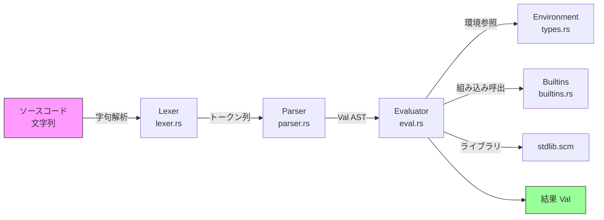
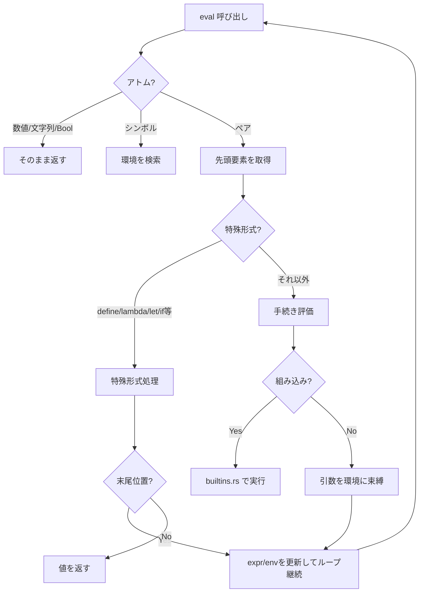
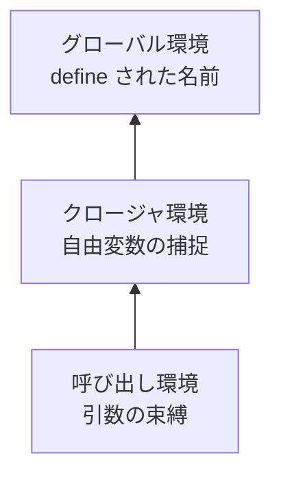
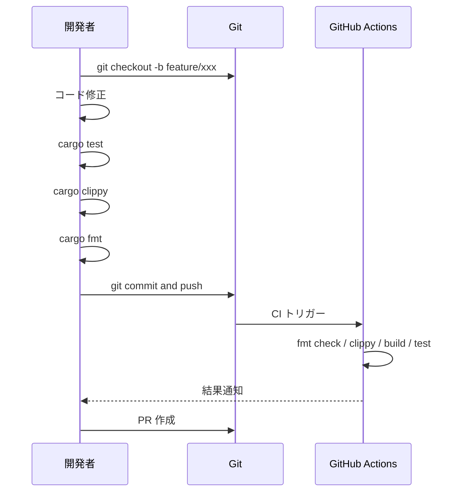
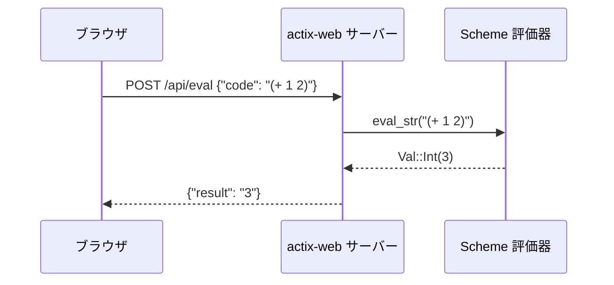
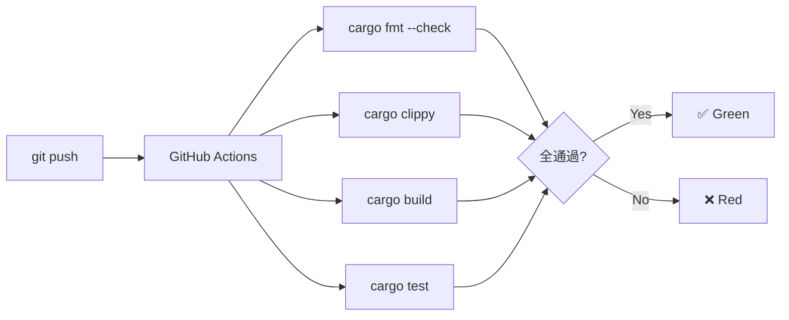

# cprustscheme オンボーディングガイド

**cprustscheme** へようこそ。RustでR5RS準拠のSchemeインタープリターを実装したプロジェクトです。

## 目次

1. [事前準備](#事前準備)
2. [ビルドと実行](#ビルドと実行)
3. [プロジェクト構成](#プロジェクト構成)
4. [アーキテクチャ概要](#アーキテクチャ概要)
5. [開発ワークフロー](#開発ワークフロー)
6. [テスト](#テスト)
7. [組み込み手続きの追加方法](#組み込み手続きの追加方法)
8. [Web UI](#web-ui)
9. [CICD](#cicd)
10. [トラブルシューティング](#トラブルシューティング)

---

## 事前準備

| ツール | バージョン | インストール方法 |
|--------|-----------|----------------|
| Rust   | 1.70以上 (stable) | https://rustup.rs |
| Git    | 任意のバージョン  | システムパッケージ |

```bash
# インストール確認
rustc --version   # rustc 1.70.0 以上
cargo --version
```

---

## ビルドと実行

```bash
# リポジトリをクローン
git clone https://github.com/suchi/cprustscheme.git
cd cprustscheme

# デバッグビルド
cargo build

# テスト実行
cargo test

# インタラクティブREPL起動
cargo run

# ファイルの実行
cargo run -- myfile.scm

# 式の評価
cargo run -- -e "(+ 1 2)"

# ファイルをロードしてREPLに入る
cargo run -- -l lib.scm -i

# Webサーバー起動 (デフォルトポート 8080)
cargo run -- --web

# リリースバイナリのビルド
cargo build --release
./target/release/cprustscheme
```

---

## プロジェクト構成

```
cprustscheme/
├── src/
│   ├── main.rs          # エントリポイント、CLIオプション解析
│   ├── types.rs         # Val, Env, Proc, SchemeError 型定義
│   ├── lexer.rs         # 字句解析器 (ソース文字列 → トークン列)
│   ├── parser.rs        # パーサー (トークン列 → Val AST)
│   ├── eval.rs          # 評価器 (TCOトランポリンループ)
│   ├── builtins.rs      # 組み込み手続き (R5RS全実装)
│   ├── repl.rs          # インタラクティブREPL (rustyline)
│   └── web.rs           # Webサーバー (actix-web)
├── scheme/
│   └── stdlib.scm       # Schemeで実装した標準ライブラリ
├── web/
│   └── static/
│       └── index.html   # Web REPL UI
├── examples/            # サンプルプログラム (章別)
│   ├── 01-basics.scm
│   ├── 02-variables.scm
│   └── ...（20ファイル）
├── docs/
│   ├── SOW.md           # 作業範囲定義書
│   ├── ONBOARDING.md    # このファイル
│   ├── R5RS-COMPLIANCE.md  # R5RS対応状況表
│   ├── TUTORIAL.md      # チュートリアルドキュメント
│   └── adr/             # アーキテクチャ決定記録
├── .github/
│   └── workflows/
│       ├── ci.yml       # CI: ビルド・テスト・lint
│       └── release.yml  # リリース: タグ → GitHub Release
├── Cargo.toml
├── .editorconfig
└── README.md
```

---

## アーキテクチャ概要

### 処理パイプライン



### 評価器の内部フロー



### 環境チェーン



各 `Env` は `Rc<RefCell<Env>>` で表現されており、複数の場所から共有・変更可能です。

### 値型 (`types.rs`)

```rust
enum Val {
    Int(i64),                      // 正確な整数
    Float(f64),                    // 不正確な浮動小数点
    Bool(bool),                    // #t, #f
    Char(char),                    // #\a, #\space, ...
    Str(Rc<RefCell<String>>),      // 可変文字列
    Symbol(Rc<str>),               // シンボル
    Pair(Rc<RefCell<(Val, Val)>>), // cons セル (可変)
    Nil,                           // 空リスト ()
    Vector(Rc<RefCell<Vec<Val>>>), // 可変ベクター
    Proc(Proc),                    // 手続き
    Port(Port),                    // 入出力ポート
    Void,                          // 未指定値
    Eof,                           // ファイル終端
}
```

---

## 開発ワークフロー



```bash
# フィーチャーブランチを作成
git checkout -b feature/my-feature

# 開発・テスト
cargo test
cargo clippy
cargo fmt

# コミット＆プッシュ
git add .
git commit -m "Add my feature"
git push origin feature/my-feature
```

---

## テスト

各モジュールに `#[cfg(test)]` ブロックでテストが記述されています。

```bash
# 全テスト実行
cargo test

# 特定のテストを実行
cargo test eval::tests::test_recursion

# 出力を表示しながらテスト
cargo test -- --nocapture
```

### テストカバレッジ

| モジュール | テスト内容 |
|-----------|-----------|
| `lexer`   | トークナイザーの精度 |
| `parser`  | AST構築 |
| `builtins`| 組み込み手続きの動作 |
| `eval`    | 式の評価、TCO、クロージャ |
| `repl`    | 入力完了検知 |

---

## 組み込み手続きの追加方法

### 1. `src/builtins.rs` に関数を追加

```rust
fn builtin_my_proc(args: &[Val]) -> SchemeResult {
    expect_len(args, 1, "my-proc")?;
    let n = as_int(&args[0], "my-proc")?;
    Ok(Val::Int(n * 2))
}
```

### 2. `register_builtins()` に登録

```rust
def!("my-proc", builtin_my_proc);
```

### 3. テストを追加

```rust
#[test]
fn test_my_proc() {
    let env = make_global_env();
    assert_eq!(
        eval_str("(my-proc 21)", &env).unwrap(),
        Val::Int(42)
    );
}
```

---

## 特殊形式の追加方法

`src/eval.rs` の `eval()` 関数にマッチアームを追加します。

```rust
"my-form" => {
    // (my-form arg1 arg2) の処理
    let arg = operands.car()?;
    return Ok(eval(arg, &env)?);
}
```

---

## stdlib.scm の拡張

`scheme/stdlib.scm` にSchemeコードを追加するだけです。起動時に自動的にロードされます。

```scheme
;; scheme/stdlib.scm に追加
(define (my-util x)
  (* x 2))
```

---

## Web UI

```bash
# Webサーバー起動
cargo run -- --web --port 8080

# ブラウザで開く
open http://localhost:8080
```



Web UIでは `Ctrl+Enter` で式を実行できます。

---

## CI/CD

### 継続的インテグレーション



```bash
# リリース作成
git tag v0.1.0
git push origin v0.1.0
```

---

## トラブルシューティング

### stdlib.scm が見つからない

プロジェクトルートから実行してください。

```bash
cd /path/to/cprustscheme
cargo run
```

### REPL の履歴が保存されない

```bash
touch .scheme_history
```

### Clippy の警告でCIが失敗する

```bash
cargo clippy --fix
cargo fmt
```

