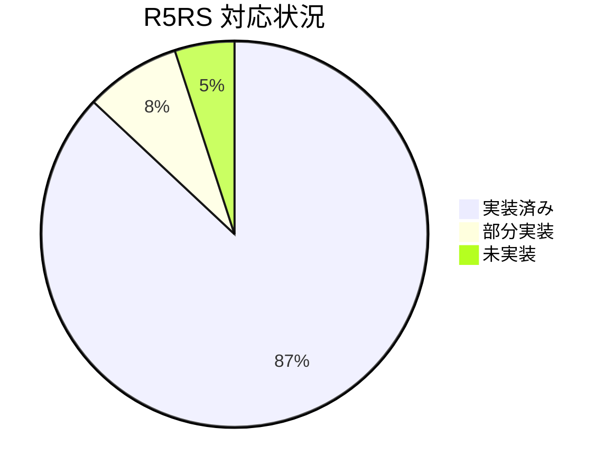

# R5RS 対応状況表

sucheme-rust の R5RS (Revised⁵ Report on the Algorithmic Language Scheme) 準拠状況です。

**凡例:**
- ✅ 実装済み
- ⚠️ 部分的に実装済み
- ❌ 未実装

---

## 実装状況の概要



---

## 1. 式 (Expressions)

### 1.1 特殊形式 (Special Forms)

| 構文 | ステータス | 備考 |
|------|-----------|------|
| `define` | ✅ | 変数定義・関数短縮形 |
| `define-syntax` | ✅ | `syntax-rules` と組み合わせ |
| `lambda` | ✅ | 固定引数・可変長引数・ドット記法 |
| `if` | ✅ | then/else 両対応 |
| `cond` | ✅ | `=>` 構文含む |
| `case` | ✅ | |
| `and` | ✅ | 短絡評価、値を返す |
| `or` | ✅ | 短絡評価、値を返す |
| `when` | ✅ | stdlib.scm で実装 |
| `unless` | ✅ | stdlib.scm で実装 |
| `let` | ✅ | |
| `let*` | ✅ | |
| `letrec` | ✅ | |
| `let-syntax` | ✅ | |
| `letrec-syntax` | ✅ | |
| `begin` | ✅ | |
| `do` | ✅ | |
| `delay` | ✅ | promise を返す |
| `force` | ✅ | promise を評価・キャッシュ |
| `quote` | ✅ | `'x` 糖衣構文含む |
| `quasiquote` | ✅ | `` `x ``、`,x`、`,@x` |
| `set!` | ✅ | |
| `values` | ✅ | |
| `call-with-values` | ✅ | |
| `let-values` | ✅ | stdlib.scm で実装 |
| `let*-values` | ✅ | stdlib.scm で実装 |

### 1.2 名前付き let (Named let)

| 構文 | ステータス | 備考 |
|------|-----------|------|
| `(let name (...) body)` | ✅ | 末尾再帰対応 |

---

## 2. 数値 (Numbers)

### 2.1 数値型

| 機能 | ステータス | 備考 |
|------|-----------|------|
| 正確な整数 (exact integer) | ✅ | i64 で実装 |
| 不正確な実数 (inexact real) | ✅ | f64 で実装 |
| 有理数 (rational) | ⚠️ | 整数除算のみ |
| 複素数 (complex) | ❌ | 未実装 |
| 基数プレフィックス (#b #o #d #x) | ✅ | |
| 正確性プレフィックス (#e #i) | ✅ | |

### 2.2 数値手続き

| 手続き | ステータス | 備考 |
|--------|-----------|------|
| `+` `-` `*` `/` | ✅ | 可変長引数 |
| `=` `<` `>` `<=` `>=` | ✅ | 可変長引数 |
| `zero?` `positive?` `negative?` | ✅ | |
| `odd?` `even?` | ✅ | |
| `max` `min` | ✅ | |
| `abs` | ✅ | |
| `quotient` `remainder` `modulo` | ✅ | |
| `gcd` `lcm` | ✅ | |
| `numerator` `denominator` | ⚠️ | 整数のみ |
| `floor` `ceiling` `truncate` `round` | ✅ | |
| `exact->inexact` `inexact->exact` | ✅ | |
| `number->string` `string->number` | ✅ | 基数対応 |
| `exact?` `inexact?` | ✅ | |
| `number?` `integer?` `rational?` | ✅ | |
| `real?` `complex?` | ✅ | |
| `exp` `log` `sin` `cos` `tan` | ✅ | |
| `asin` `acos` `atan` | ✅ | 1引数・2引数形式 |
| `sqrt` `expt` | ✅ | |

---

## 3. 文字列 (Strings)

| 手続き | ステータス | 備考 |
|--------|-----------|------|
| `string?` | ✅ | |
| `make-string` | ✅ | |
| `string` | ✅ | |
| `string-length` | ✅ | |
| `string-ref` | ✅ | |
| `string-set!` | ✅ | |
| `string=?` `string<?` `string>?` | ✅ | |
| `string<=?` `string>=?` | ✅ | |
| `string-ci=?` 等 | ✅ | |
| `substring` | ✅ | |
| `string-append` | ✅ | 可変長引数 |
| `string->list` `list->string` | ✅ | |
| `string-copy` | ✅ | |
| `string-fill!` | ✅ | |
| `string-upcase` `string-downcase` | ✅ | |
| `string->symbol` `symbol->string` | ✅ | |
| `string->number` `number->string` | ✅ | |
| `string-split` | ✅ | stdlib.scm |
| `string-join` | ✅ | stdlib.scm |
| `string-prefix?` `string-suffix?` | ✅ | stdlib.scm |
| `string-contains` | ✅ | stdlib.scm |
| `string-trim` | ✅ | stdlib.scm |

---

## 4. 文字 (Characters)

| 手続き | ステータス | 備考 |
|--------|-----------|------|
| `char?` | ✅ | |
| `char=?` `char<?` `char>?` 等 | ✅ | |
| `char-ci=?` 等 | ✅ | |
| `char->integer` `integer->char` | ✅ | |
| `char-alphabetic?` | ✅ | |
| `char-numeric?` | ✅ | |
| `char-whitespace?` | ✅ | |
| `char-upper-case?` `char-lower-case?` | ✅ | |
| `char-upcase` `char-downcase` | ✅ | |
| 文字リテラル `#\a` `#\space` 等 | ✅ | 全R5RS文字リテラル |

---

## 5. ブーリアン (Booleans)

| 手続き | ステータス | 備考 |
|--------|-----------|------|
| `not` | ✅ | |
| `boolean?` | ✅ | |
| `#t` `#f` | ✅ | |

---

## 6. リストとペア (Lists and Pairs)

| 手続き | ステータス | 備考 |
|--------|-----------|------|
| `pair?` `null?` `list?` | ✅ | |
| `cons` `car` `cdr` | ✅ | |
| `caar` `cadr` ... `cddddr` | ✅ | |
| `set-car!` `set-cdr!` | ✅ | |
| `list` `list*` | ✅ | |
| `length` | ✅ | |
| `append` | ✅ | 可変長引数 |
| `reverse` | ✅ | |
| `list-tail` | ✅ | |
| `list-ref` | ✅ | |
| `list-copy` | ✅ | stdlib.scm |
| `member` `memq` `memv` | ✅ | |
| `assoc` `assq` `assv` | ✅ | |
| `for-each` | ✅ | 複数リスト対応 |
| `map` | ✅ | 複数リスト対応 |
| `filter` | ✅ | stdlib.scm |
| `partition` | ✅ | stdlib.scm |
| `fold-left` `fold-right` | ✅ | stdlib.scm |
| `reduce` | ✅ | stdlib.scm |
| `any` `every` | ✅ | stdlib.scm |
| `last-pair` | ✅ | stdlib.scm |
| `iota` | ✅ | stdlib.scm |
| `sort` | ✅ | stdlib.scm (マージソート) |
| `sort!` | ✅ | stdlib.scm |
| `list-index` | ✅ | stdlib.scm |
| `flatten` | ✅ | stdlib.scm |
| `zip` | ✅ | stdlib.scm |
| `unzip1` `unzip2` | ✅ | stdlib.scm |

---

## 7. ベクター (Vectors)

| 手続き | ステータス | 備考 |
|--------|-----------|------|
| `vector?` | ✅ | |
| `make-vector` | ✅ | |
| `vector` | ✅ | |
| `vector-length` | ✅ | |
| `vector-ref` | ✅ | |
| `vector-set!` | ✅ | |
| `vector->list` `list->vector` | ✅ | |
| `vector-fill!` | ✅ | |
| `vector-map` | ✅ | stdlib.scm |
| `vector-for-each` | ✅ | stdlib.scm |
| `vector-copy` | ✅ | stdlib.scm |
| `vector-append` | ✅ | stdlib.scm |

---

## 8. 入出力 (I/O)

| 手続き | ステータス | 備考 |
|--------|-----------|------|
| `display` | ✅ | ポート引数対応 |
| `write` | ✅ | ポート引数対応 |
| `newline` | ✅ | ポート引数対応 |
| `read` | ✅ | |
| `read-char` | ✅ | |
| `peek-char` | ✅ | |
| `write-char` | ✅ | |
| `read-line` | ✅ | |
| `eof-object?` `eof-object` | ✅ | |
| `open-input-file` | ✅ | |
| `open-output-file` | ✅ | |
| `close-input-port` `close-output-port` | ✅ | |
| `call-with-input-file` | ✅ | |
| `call-with-output-file` | ✅ | |
| `with-input-from-file` | ✅ | |
| `with-output-to-file` | ✅ | |
| `current-input-port` `current-output-port` | ✅ | |
| `input-port?` `output-port?` | ✅ | |
| `open-input-string` | ✅ | |
| `open-output-string` | ✅ | |
| `get-output-string` | ✅ | |
| `with-input-from-string` | ✅ | |
| `with-output-to-string` | ✅ | |

---

## 9. 制御 (Control)

| 手続き/構文 | ステータス | 備考 |
|------------|-----------|------|
| `apply` | ✅ | |
| `map` `for-each` | ✅ | 複数リスト |
| `call-with-current-continuation` (`call/cc`) | ✅ | エスケープ継続 |
| `call/cc` | ✅ | `call-with-current-continuation` の別名 |
| `dynamic-wind` | ⚠️ | 基本実装 |
| `values` `call-with-values` | ✅ | |
| `guard` | ✅ | stdlib.scm (R7RS-like) |
| `error` | ✅ | |
| `with-exception-handler` | ⚠️ | 基本実装 |
| `raise` | ✅ | |

---

## 10. 評価 (Eval)

| 手続き | ステータス | 備考 |
|--------|-----------|------|
| `eval` | ✅ | |
| `scheme-report-environment` | ⚠️ | グローバル環境を返す |
| `null-environment` | ⚠️ | |
| `interaction-environment` | ✅ | |

---

## 11. マクロ (Macros)

| 機能 | ステータス | 備考 |
|------|-----------|------|
| `define-syntax` | ✅ | |
| `syntax-rules` | ✅ | `...` パターン対応 |
| `let-syntax` | ✅ | |
| `letrec-syntax` | ✅ | |
| ハイジーンマクロ | ✅ | syntax-rules による |
| `define-record-type` | ✅ | stdlib.scm (SRFI-9準拠) |

---

## 12. R5RS 付録マクロ (Appendix Macros)

R5RS 付録 に含まれる推奨マクロ・手続き:

| 名前 | ステータス | 実装場所 |
|------|-----------|---------|
| `when` | ✅ | stdlib.scm |
| `unless` | ✅ | stdlib.scm |
| `define-record-type` | ✅ | stdlib.scm |
| `let-values` | ✅ | stdlib.scm |
| `let*-values` | ✅ | stdlib.scm |
| `fluid-let` | ✅ | stdlib.scm |
| `while` | ✅ | stdlib.scm |
| `until` | ✅ | stdlib.scm |
| `push!` | ✅ | stdlib.scm |
| `pop!` | ✅ | stdlib.scm |
| `swap!` | ✅ | stdlib.scm |
| `dotimes` | ✅ | stdlib.scm |
| `dolist` | ✅ | stdlib.scm |
| `compose` | ✅ | stdlib.scm |

---

## 13. システム

| 手続き | ステータス | 備考 |
|--------|-----------|------|
| `exit` | ✅ | |
| `error` | ✅ | |
| `load` | ✅ | |
| `command-line` | ⚠️ | `*argv*` で代替 |
| `get-universal-time` | ❌ | 未実装 |

---

## 既知の制限

1. **完全な継続 (full continuations)**: `call/cc` はエスケープ継続として実装されており、継続の再呼び出し（コルーチン等）は限定的なサポート
2. **有理数・複素数**: 現在は整数と浮動小数点数のみ対応
3. **末尾位置の厳密な検出**: 一部のネストしたコンテキストでTCOが働かない場合がある
4. **ポートの詳細制御**: バイナリポート等は未実装

---

## サンプルコード

```scheme
;; R5RS の主要な機能を一通り確認
(define-record-type <point>
  (make-point x y) point?
  (x point-x) (y point-y))

(define p (make-point 3 4))
(display (point-x p))  ; => 3

;; マクロ
(let-values (((q r) (floor/ 17 5)))
  (display q) ; => 3
  (display r)) ; => 2

;; 末尾再帰
(define (sum n acc)
  (if (= n 0) acc (sum (- n 1) (+ acc n))))
(display (sum 1000000 0))  ; => 500000500000

;; call/cc
(display (call/cc (lambda (k) (k 42) 100)))  ; => 42
```
