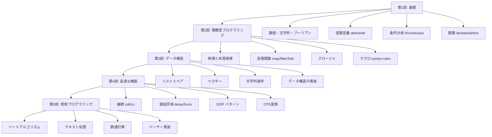

# sucheme-rust チュートリアル

RustでR5RS準拠のSchemeインタープリター `sucheme-rust` を使って、Schemeプログラミングを学ぶ総合ガイドです。

## 前提

```bash
# インストール
cargo install --path .

# または直接実行
cargo run -- -e "(display \"Hello, Scheme!\")"
```

## 学習マップ



---

## 第1部: 基礎

### 1-1. 式と評価

Schemeはすべてが「式」です。式を評価すると値が返ります。

```scheme
;; 数値リテラル
42        ; => 42
3.14      ; => 3.14

;; 文字列リテラル
"Hello"   ; => "Hello"

;; ブーリアン
#t        ; => #t (真)
#f        ; => #f (偽)

;; 文字リテラル
#\a       ; => a (文字 a)
#\space   ; => (スペース文字)
#\newline ; => (改行文字)
```

### 1-2. 関数呼び出し

Schemeの構文は `(関数名 引数1 引数2 ...)` の形式です。

```scheme
;; 算術演算
(+ 1 2)        ; => 3
(- 10 3)       ; => 7
(* 4 5)        ; => 20
(/ 10 2)       ; => 5

;; 複数引数
(+ 1 2 3 4 5)  ; => 15
(* 2 3 4)      ; => 24

;; ネスト
(+ (* 2 3) (* 4 5))  ; => 26

;; 比較
(> 5 3)   ; => #t
(< 5 3)   ; => #f
(= 5 5)   ; => #t
(>= 5 5)  ; => #t
```

### 1-3. 変数の定義

```scheme
;; define で変数を定義
(define x 42)
(display x)    ; => 42

;; 文字列
(define greeting "Hello, Scheme!")
(display greeting)

;; 計算結果を変数に
(define pi 3.14159)
(define radius 5)
(define area (* pi radius radius))
(display area)  ; => 78.53975
```

### 1-4. if 式

```scheme
;; (if 条件 真の場合 偽の場合)
(if #t "yes" "no")   ; => "yes"
(if #f "yes" "no")   ; => "no"

;; 条件式
(if (> 5 3)
    "5は3より大きい"
    "5は3以下")
; => "5は3より大きい"

;; else なし (falseを返す)
(if (= 1 2) "equal")  ; => (void)
```

### 1-5. cond 式 (多分岐)

```scheme
(define (classify n)
  (cond
    ((> n 0)  "正の数")
    ((< n 0)  "負の数")
    (else     "ゼロ")))

(display (classify 5))   ; => 正の数
(display (classify -3))  ; => 負の数
(display (classify 0))   ; => ゼロ
```

### 1-6. case 式

```scheme
(define (season month)
  (case month
    ((3 4 5)   "春")
    ((6 7 8)   "夏")
    ((9 10 11) "秋")
    ((12 1 2)  "冬")
    (else      "不明")))

(display (season 7))   ; => 夏
(display (season 11))  ; => 秋
```

### 1-7. let 系の変数束縛

```scheme
;; let: 並列束縛
(let ((a 1) (b 2) (c 3))
  (+ a b c))  ; => 6

;; let*: 順次束縛 (前の変数を参照できる)
(let* ((x 10)
       (y (* x 2))  ; xを参照
       (z (+ x y)))
  z)  ; => 30

;; letrec: 相互再帰
(letrec ((even? (lambda (n)
                  (if (= n 0) #t (odd? (- n 1)))))
         (odd?  (lambda (n)
                  (if (= n 0) #f (even? (- n 1))))))
  (even? 10))  ; => #t
```

---

## 第2部: 関数型プログラミング

### 2-1. lambda による無名関数

```scheme
;; lambda の基本
(lambda (x) (* x x))  ; 二乗する関数

;; すぐ呼び出す
((lambda (x y) (+ x y)) 3 4)  ; => 7

;; 変数に代入
(define square (lambda (x) (* x x)))
(square 5)  ; => 25

;; 短縮形 (define の関数版)
(define (square x) (* x x))
(square 5)  ; => 25
```

### 2-2. 可変長引数

```scheme
;; . rest で残りの引数を受け取る
(define (sum . nums)
  (apply + nums))

(sum 1 2 3 4 5)  ; => 15

;; 必須引数 + 残り
(define (greet name . parts)
  (apply string-append
    (cons (string-append "Hello, " name "!")
          (if (null? parts) '() parts))))

(greet "Alice")           ; => Hello, Alice!
(greet "Bob" " How are you?")  ; => Hello, Bob! How are you?
```

### 2-3. 再帰

```scheme
;; 階乗 (通常の再帰)
(define (factorial n)
  (if (<= n 1)
      1
      (* n (factorial (- n 1)))))

(factorial 5)   ; => 120
(factorial 10)  ; => 3628800

;; フィボナッチ数列
(define (fib n)
  (cond
    ((= n 0) 0)
    ((= n 1) 1)
    (else (+ (fib (- n 1)) (fib (- n 2))))))

(map fib '(0 1 2 3 4 5 6 7 8 9))
; => (0 1 1 2 3 5 8 13 21 34)
```

### 2-4. 末尾再帰 (TCO)

```scheme
;; 末尾再帰版の階乗 (スタックを消費しない)
(define (factorial-iter n acc)
  (if (<= n 1)
      acc
      (factorial-iter (- n 1) (* n acc))))

(define (fact n) (factorial-iter n 1))
(fact 100)  ; 大きな数でも安全

;; 名前付き let でループを表現
(define (sum-to n)
  (let loop ((i 0) (acc 0))
    (if (> i n)
        acc
        (loop (+ i 1) (+ acc i)))))

(sum-to 100)  ; => 5050
```

### 2-5. 高階関数

```scheme
;; 関数を引数に取る
(define (apply-twice f x) (f (f x)))
(apply-twice (lambda (x) (* x 2)) 3)  ; => 12

;; 関数を返す
(define (make-multiplier n)
  (lambda (x) (* x n)))

(define triple (make-multiplier 3))
(triple 7)  ; => 21

;; map: リストの各要素に関数を適用
(map (lambda (x) (* x x)) '(1 2 3 4 5))
; => (1 4 9 16 25)

;; filter: 条件を満たす要素を選択
(filter even? '(1 2 3 4 5 6 7 8))
; => (2 4 6 8)

;; fold-right: 右から畳み込み
(fold-right + 0 '(1 2 3 4 5))  ; => 15
(fold-right cons '() '(1 2 3))  ; => (1 2 3)

;; fold-left: 左から畳み込み
(fold-left (lambda (acc x) (+ acc x)) 0 '(1 2 3 4 5))
; => 15
```

### 2-6. クロージャ

```scheme
;; クロージャ: 関数が定義された環境を閉じ込める
(define (make-counter)
  (let ((n 0))
    (lambda ()
      (set! n (+ n 1))
      n)))

(define c1 (make-counter))
(define c2 (make-counter))

(c1)  ; => 1
(c1)  ; => 2
(c1)  ; => 3
(c2)  ; => 1  (独立したカウンター)

;; アキュムレーター
(define (make-accumulator init)
  (let ((total init))
    (lambda (x)
      (set! total (+ total x))
      total)))

(define acc (make-accumulator 0))
(acc 10)  ; => 10
(acc 5)   ; => 15
(acc 20)  ; => 35
```

### 2-7. for-each

```scheme
;; リストの各要素に副作用のある操作
(for-each display '(1 2 3 4 5))
; 出力: 12345

(for-each
  (lambda (x)
    (display x)
    (display " "))
  '(apple banana cherry))
; 出力: apple banana cherry

;; 複数リスト
(for-each
  (lambda (name score)
    (display name) (display ": ") (display score) (newline))
  '("Alice" "Bob" "Carol")
  '(90 85 92))
; Alice: 90  Bob: 85  Carol: 92
```

---

## 第3部: データ構造

### 3-1. リストとペア

```scheme
;; ペアの構築
(cons 1 2)         ; => (1 . 2)
(cons 1 '())       ; => (1)
(cons 1 (cons 2 (cons 3 '())))  ; => (1 2 3)

;; リストの構築
(list 1 2 3 4 5)   ; => (1 2 3 4 5)
'(a b c)           ; => (a b c) (クォート)

;; アクセス
(car '(1 2 3))     ; => 1
(cdr '(1 2 3))     ; => (2 3)
(cadr '(1 2 3))    ; => 2
(caddr '(1 2 3))   ; => 3

;; リスト操作
(length '(a b c d))      ; => 4
(reverse '(1 2 3))       ; => (3 2 1)
(append '(1 2) '(3 4))   ; => (1 2 3 4)
(list-ref '(a b c d) 2)  ; => c

;; 検索
(member 3 '(1 2 3 4))         ; => (3 4)
(assoc "b" '(("a" 1) ("b" 2))) ; => ("b" 2)
```

### 3-2. ベクター

```scheme
;; ベクターリテラル
#(1 2 3 4 5)

;; 作成
(vector 'a 'b 'c)       ; => #(a b c)
(make-vector 5 0)        ; => #(0 0 0 0 0)

;; アクセスと変更
(vector-ref #(10 20 30) 1)   ; => 20
(define v (vector 1 2 3))
(vector-set! v 0 99)
v  ; => #(99 2 3)

;; 変換
(vector->list #(1 2 3))  ; => (1 2 3)
(list->vector '(a b c))  ; => #(a b c)

;; イテレーション
(vector-for-each
  (lambda (x) (display x) (display " "))
  #(10 20 30))
; => 10 20 30

(vector-map (lambda (x) (* x 2)) #(1 2 3))
; => #(2 4 6)
```

### 3-3. 文字列の高度な操作

```scheme
;; 基本操作
(string-length "Hello")       ; => 5
(string-ref "Hello" 1)        ; => e
(substring "Hello, World!" 7 12)  ; => World

;; 変換
(string->list "abc")    ; => (a b c)
(list->string '(#\H #\i))  ; => Hi

;; 検索と変換 (stdlib)
(string-split "a,b,c" ",")  ; => ("a" "b" "c")
(string-join '("foo" "bar") "-")  ; => foo-bar
(string-contains "Hello, World!" "World")  ; => 7

;; 大文字/小文字
(string-upcase "hello")   ; => HELLO
(string-downcase "WORLD") ; => world
```

### 3-4. 連想リスト (alist)

```scheme
;; 連想リスト (キー. 値) のリスト
(define db
  '((alice . 30)
    (bob   . 25)
    (carol . 35)))

;; 検索
(assq 'bob db)    ; => (bob . 25)
(cdr (assq 'bob db))  ; => 25

;; 更新 (非破壊的)
(define (alist-set alist key val)
  (cons (cons key val)
        (filter (lambda (pair) (not (eq? (car pair) key)))
                alist)))

(define db2 (alist-set db 'bob 26))
(cdr (assq 'bob db2))   ; => 26
(cdr (assq 'bob db))    ; => 25 (元は変わらない)
```

### 3-5. define-record-type

```scheme
;; レコード型の定義
(define-record-type <point>
  (make-point x y)
  point?
  (x point-x set-point-x!)
  (y point-y set-point-y!))

(define p (make-point 3 4))
(point? p)        ; => #t
(point-x p)       ; => 3
(set-point-x! p 10)
(point-x p)       ; => 10

;; 距離計算
(define (distance p1 p2)
  (let ((dx (- (point-x p2) (point-x p1)))
        (dy (- (point-y p2) (point-y p1))))
    (sqrt (+ (* dx dx) (* dy dy)))))

(distance (make-point 0 0) (make-point 3 4))  ; => 5.0
```

---

## 第4部: 高度な機能

### 4-1. do ループ

```scheme
;; (do ((変数 初期値 更新式) ...) (終了条件 結果) 本体)
(do ((i 0 (+ i 1))
     (sum 0 (+ sum i)))
    ((> i 100) sum))  ; => 5050

;; リストの要素を表示
(do ((lst '(1 2 3 4 5) (cdr lst)))
    ((null? lst))
  (display (car lst))
  (display " "))
; => 1 2 3 4 5
```

### 4-2. quasiquote (準引用)

```scheme
;; バッククォートと , でテンプレートを作る
(define x 42)
`(the answer is ,x)  ; => (the answer is 42)

;; ,@ でリストを展開
(define lst '(1 2 3))
`(a ,@lst b)  ; => (a 1 2 3 b)

;; マクロ生成に使う
(define-syntax my-list
  (syntax-rules ()
    ((my-list x ...)
     `(,x ...))))

(my-list 1 2 3)  ; => (1 2 3)
```

### 4-3. delay / force (遅延評価)

```scheme
;; delay: 評価を遅らせる
(define p (delay (* 6 7)))
;; この時点では評価されていない

;; force: 評価を強制する (一度評価したら結果をキャッシュ)
(force p)  ; => 42
(force p)  ; => 42 (キャッシュを返す)

;; 無限リストのシミュレーション
(define-syntax cons-stream
  (syntax-rules ()
    ((cons-stream a b) (cons a (delay b)))))

(define stream-cdr (lambda (s) (force (cdr s))))

(define (integers-from n)
  (cons-stream n (integers-from (+ n 1))))

(define nats (integers-from 1))
(car nats)                   ; => 1
(car (stream-cdr nats))      ; => 2
(car (stream-cdr (stream-cdr nats)))  ; => 3
```

### 4-4. call/cc (継続)

```scheme
;; call/cc: 現在の継続をキャプチャ
(call-with-current-continuation
  (lambda (k)
    (k 42)    ; 42を継続に渡して即座に返る
    (+ 1 2))) ; ここには到達しない
; => 42

;; 略称 call/cc
(call/cc (lambda (k) (k 42)))  ; => 42

;; 早期脱出
(define (find-first pred lst)
  (call/cc
    (lambda (return)
      (for-each (lambda (x)
                  (when (pred x) (return x)))
                lst)
      #f)))

(find-first even? '(1 3 5 4 7))  ; => 4
(find-first even? '(1 3 5 7))    ; => #f

;; ネストしたループから脱出
(call/cc
  (lambda (break)
    (for-each
      (lambda (i)
        (for-each
          (lambda (j)
            (when (= (* i j) 12) (break (list i j))))
          '(1 2 3 4 5 6)))
      '(2 3 4 5 6))))
; => (2 6) (最初に積が12になる組み合わせ)
```

### 4-5. values と call-with-values

```scheme
;; 複数値を返す
(define (divide a b)
  (values (quotient a b) (remainder a b)))

;; call-with-values で受け取る
(call-with-values
  (lambda () (divide 17 5))
  (lambda (q r)
    (display q) (display " 余り ") (display r)))
; => 3 余り 2

;; let-values (stdlib)
(let-values (((q r) (divide 17 5)))
  (display q) (display " ") (display r))
; => 3 2
```

### 4-6. マクロ (syntax-rules)

```scheme
;; 基本的なマクロ
(define-syntax swap!
  (syntax-rules ()
    ((swap! a b)
     (let ((tmp a))
       (set! a b)
       (set! b tmp)))))

(define x 1)
(define y 2)
(swap! x y)
x  ; => 2
y  ; => 1

;; パターンの繰り返し (...) を使う
(define-syntax my-list
  (syntax-rules ()
    ((my-list) '())
    ((my-list x rest ...) (cons x (my-list rest ...)))))

(my-list 1 2 3 4 5)  ; => (1 2 3 4 5)

;; and マクロの実装
(define-syntax my-and
  (syntax-rules ()
    ((my-and) #t)
    ((my-and x) x)
    ((my-and x y ...) (if x (my-and y ...) #f))))

(my-and 1 2 3)    ; => 3
(my-and 1 #f 3)   ; => #f
```

---

## 第5部: 実用プログラミング

### 5-1. ソートアルゴリズム

```scheme
;; クイックソート
(define (quicksort lst)
  (if (or (null? lst) (null? (cdr lst)))
      lst
      (let ((pivot (car lst)))
        (let ((smaller (filter (lambda (x) (< x pivot)) (cdr lst)))
              (larger  (filter (lambda (x) (>= x pivot)) (cdr lst))))
          (append (quicksort smaller) (list pivot) (quicksort larger))))))

(quicksort '(3 1 4 1 5 9 2 6 5 3))
; => (1 1 2 3 3 4 5 5 6 9)

;; マージソート
(define (merge lst1 lst2)
  (cond
    ((null? lst1) lst2)
    ((null? lst2) lst1)
    ((<= (car lst1) (car lst2))
     (cons (car lst1) (merge (cdr lst1) lst2)))
    (else
     (cons (car lst2) (merge lst1 (cdr lst2))))))

;; stdlib の sort を使う
(sort < '(3 1 4 1 5 9 2 6))
; => (1 1 2 3 4 5 6 9)

(sort string<? '("banana" "apple" "cherry"))
; => ("apple" "banana" "cherry")
```

### 5-2. 文字列処理

```scheme
;; パリンドロームチェック
(define (palindrome? str)
  (let ((chars (string->list (string-downcase str))))
    (equal? chars (reverse chars))))

(palindrome? "racecar")  ; => #t
(palindrome? "hello")    ; => #f

;; 文字列を単語に分割
(define words (string-split "hello world scheme" " "))
words  ; => ("hello" "world" "scheme")

;; 文字列の各単語を大文字に
(string-join
  (map string-upcase words)
  " ")
; => "HELLO WORLD SCHEME"

;; 文字列の出現回数を数える
(define (count-occurrences target str)
  (let loop ((pos 0) (count 0))
    (let ((found (string-contains str target pos)))
      (if found
          (loop (+ found 1) (+ count 1))
          count))))
```

### 5-3. 数値計算

```scheme
;; ユークリッドのアルゴリズム (GCD)
(define (my-gcd a b)
  (if (= b 0)
      a
      (my-gcd b (modulo a b))))

(my-gcd 48 18)  ; => 6
(my-gcd 100 75) ; => 25

;; 素因数分解
(define (factorize n)
  (let loop ((n n) (d 2) (factors '()))
    (cond
      ((> (* d d) n)
       (if (> n 1)
           (reverse (cons n factors))
           (reverse factors)))
      ((= (modulo n d) 0)
       (loop (/ n d) d (cons d factors)))
      (else
       (loop n (+ d 1) factors)))))

(factorize 360)   ; => (2 2 2 3 3 5)
(factorize 1001)  ; => (7 11 13)

;; 統計
(define data '(85 92 78 95 88 76 91 83))

(define mean
  (/ (apply + data) (length data)))
; => 86 (正確な有理数)

(define variance
  (/ (apply + (map (lambda (x) (square (- x mean))) data))
     (length data)))
```

### 5-4. 木構造の処理

```scheme
;; 二分探索木
(define (bst-insert tree val)
  (cond
    ((not tree) (list val '() '()))
    ((< val (car tree))
     (list (car tree) (bst-insert (cadr tree) val) (caddr tree)))
    ((> val (car tree))
     (list (car tree) (cadr tree) (bst-insert (caddr tree) val)))
    (else tree)))

(define (bst-inorder tree)
  (if (not tree)
      '()
      (append (bst-inorder (cadr tree))
              (list (car tree))
              (bst-inorder (caddr tree)))))

(define bst
  (fold-left bst-insert #f '(5 3 7 1 4 6 8)))

(bst-inorder bst)
; => (1 3 4 5 6 7 8)
```

### 5-5. Schemeでインタープリター実装

```scheme
;; 小さなLispインタープリター
(define (my-eval expr env)
  (cond
    ;; 数値は自己評価的
    ((number? expr) expr)
    ;; シンボルは環境から検索
    ((symbol? expr)
     (cdr (assq expr env)))
    ;; ペアは関数呼び出し
    ((pair? expr)
     (case (car expr)
       ;; 特殊形式: quote
       ((quote) (cadr expr))
       ;; 特殊形式: if
       ((if)
        (if (my-eval (cadr expr) env)
            (my-eval (caddr expr) env)
            (my-eval (cadddr expr) env)))
       ;; 特殊形式: lambda
       ((lambda)
        (let ((params (cadr expr))
              (body   (caddr expr)))
          (list 'closure params body env)))
       ;; 関数呼び出し
       (else
        (let ((proc (my-eval (car expr) env))
              (args (map (lambda (a) (my-eval a env)) (cdr expr))))
          (my-apply proc args)))))
    (else (error "Cannot eval" expr))))

(define (my-apply proc args)
  (cond
    ;; 組み込み手続き
    ((procedure? proc) (apply proc args))
    ;; クロージャ
    ((and (pair? proc) (eq? (car proc) 'closure))
     (let* ((params (cadr proc))
            (body   (caddr proc))
            (env    (cadddr proc))
            (new-env (append (map cons params args) env)))
       (my-eval body new-env)))
    (else (error "Not a procedure" proc))))

;; 使用例
(define initial-env
  (list (cons '+ +)
        (cons '* *)
        (cons '- -)
        (cons 'square (lambda (x) (* x x)))))

(my-eval '(+ 1 2) initial-env)          ; => 3
(my-eval '(* (+ 1 2) (+ 3 4)) initial-env)  ; => 21
(my-eval '((lambda (x) (* x x)) 5) initial-env)  ; => 25
```

### 5-6. CPS (継続渡しスタイル)

```scheme
;; 通常スタイル → CPSに変換
;; 通常:
(define (factorial n)
  (if (<= n 1) 1 (* n (factorial (- n 1)))))

;; CPS:
(define (factorial-cps n k)
  (if (<= n 1)
      (k 1)
      (factorial-cps (- n 1)
                     (lambda (r) (k (* n r))))))

(factorial-cps 5 display)  ; => 120

;; CPSによる非ローカル脱出
(define (product-cps lst k)
  (cond
    ((null? lst) (k 1))
    ((= (car lst) 0) 0)  ; 早期返却 (kを使わない)
    (else
     (product-cps (cdr lst)
                  (lambda (rest) (k (* (car lst) rest)))))))

(product-cps '(1 2 3 4 5) display)   ; => 120
(product-cps '(1 2 0 4 5) display)   ; => 0 (早期返却)
```

---

## 付録: クイックリファレンス

### よく使う関数一覧

```scheme
;; 算術
(+ 1 2)   (- 5 3)  (* 4 5)  (/ 10 2)
(abs -5)  (max 3 7)  (min 1 4)
(expt 2 10)  (sqrt 25)  (floor 3.7)

;; リスト
(cons 1 '(2 3))  (car '(1 2 3))  (cdr '(1 2 3))
(list 1 2 3)  (length '(a b c))  (reverse '(1 2 3))
(append '(1 2) '(3 4))  (map f lst)  (filter pred lst)
(for-each f lst)  (member x lst)  (assoc k alist)

;; 文字列
(string-length "hi")  (string-append "a" "b")
(substring "hello" 1 3)  (string->list "abc")
(string->number "42")  (number->string 42)

;; 述語
(null? '())  (pair? '(1 2))  (number? 42)
(string? "hi")  (symbol? 'x)  (boolean? #t)
(procedure? car)  (equal? '(1 2) '(1 2))

;; 制御
(if test then else)  (cond clause...)
(let ((x 1)) body)  (define (f x) body)
(begin expr1 expr2 ...)
(apply f args)  (map f lst)
```

### サンプルプログラムの実行方法

```bash
# 各章のサンプルを実行
sucheme-rust examples/01-basics.scm
sucheme-rust examples/02-variables.scm
sucheme-rust examples/03-functions.scm
sucheme-rust examples/04-conditionals.scm
sucheme-rust examples/05-lists.scm
sucheme-rust examples/06-strings.scm
sucheme-rust examples/07-vectors.scm
sucheme-rust examples/08-tail-recursion.scm
sucheme-rust examples/09-higher-order.scm
sucheme-rust examples/10-macros.scm
sucheme-rust examples/11-practical-math.scm
sucheme-rust examples/12-data-structures.scm
sucheme-rust examples/13-io.scm
sucheme-rust examples/14-sorting-algorithms.scm
sucheme-rust examples/15-oop.scm
sucheme-rust examples/16-continuations.scm
sucheme-rust examples/17-pattern-matching.scm
sucheme-rust examples/18-lazy-evaluation.scm
sucheme-rust examples/19-practical-programs.scm
sucheme-rust examples/20-advanced.scm

# 対話型で試す
sucheme-rust

# Web UIで試す
sucheme-rust --web
# ブラウザで http://localhost:8080 を開く
```
