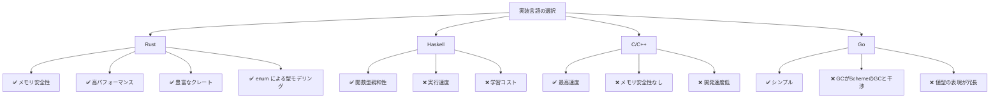

# ADR-001: Schemeインタープリターの実装言語にRustを選択

**日付:** 2026-02-21
**ステータス:** 承認済み

## 背景

R5RS準拠のSchemeインタープリターをどの言語で実装するかの決定が必要だった。

## 候補言語の比較

## 決定

**Rustを使用する。**

## 理由

- **メモリ安全性**: GCなしでのメモリ管理。`Rc<RefCell<>>` でSchemeの共有可変状態を安全に扱える
- **パフォーマンス**: コンパイル済みバイナリで高速実行
- **エコシステム**: actix-web (Web)、rustyline (REPL)、serde (JSON) の充実したクレート
- **型システム**: `enum` によるScheme値型の自然なモデリング

## 結果

- Rustのライフタイムシステムにより、Schemeの環境チェーン実装に `Rc<RefCell<>>` パターンが必要
- 完全な継続 (call/cc) の実装が複雑になるため、初期フェーズでは制限付きのエスケープ継続のみ
- `Rc<RefCell<>>` によるサイクルガベージコレクションは将来の課題
