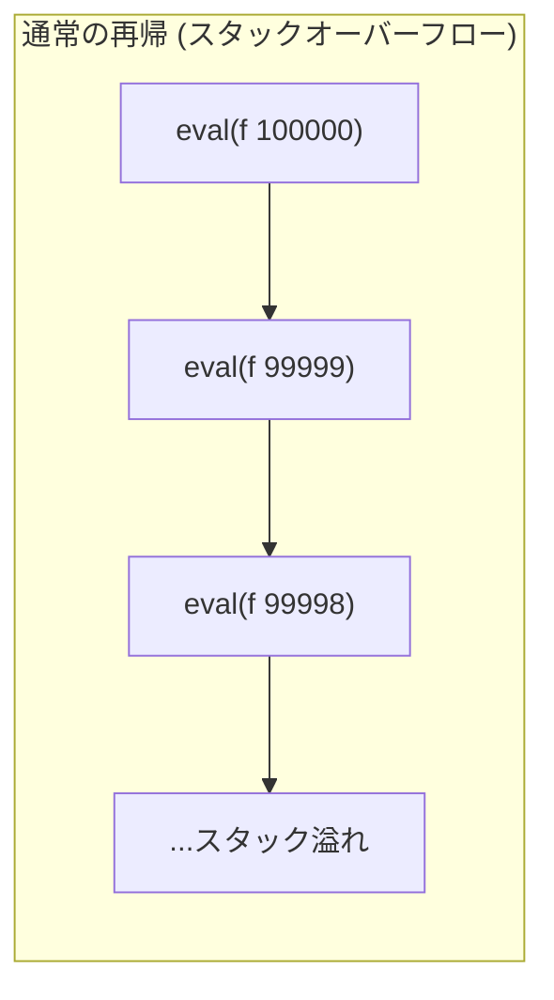
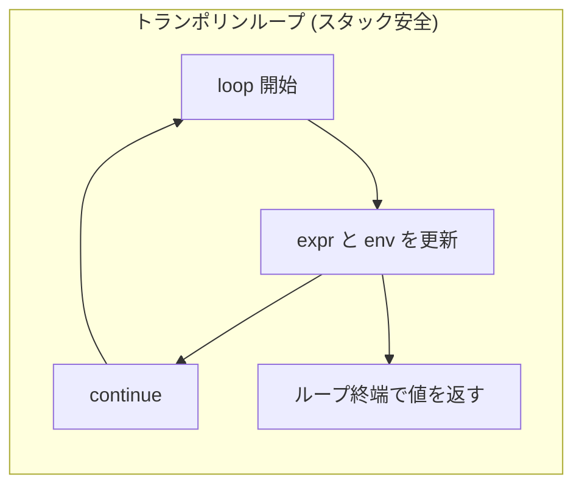

# ADR-002: トランポリンループによる末尾呼び出し最適化

**日付:** 2026-02-21
**ステータス:** 承認済み

## 背景

R5RSはプロパーテール呼び出し (proper tail calls) を必須要件としている。
Rustはネイティブな末尾呼び出し最適化をサポートしていない。

## 問題



## 決定

評価器 (`eval.rs`) にトランポリンループパターンを使用する。



## 実装

```rust
pub fn eval(mut expr: Val, mut env: Rc<RefCell<Env>>) -> SchemeResult {
    loop {
        match expr {
            // 末尾位置では expr と env を更新して continue
            Val::Pair(_) => {
                // ...特殊形式や手続き呼び出し...
                expr = tail_expr;
                env = new_env;
                continue;  // ← スタックを消費しない!
            }
            // 終端値はそのまま返す
            other => return Ok(other),
        }
    }
}
```

## 理由

- Rustのスタックを消費せずに深い再帰をサポートできる
- 実装が単純：`expr` と `env` を更新して `continue` するだけ
- 評価器の主ループが1つになり見通しが良い

## 結果

- `apply()` 関数は内部用途（`map` 等）のため完全TCOではない
- 末尾再帰の100,000回呼び出しテストで動作確認済み
- 相互末尾再帰も正しく最適化される
