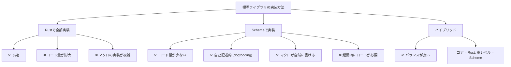
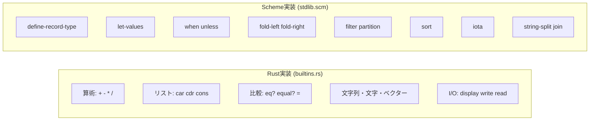

# ADR-003: 標準ライブラリをScheme自身で実装

**日付:** 2026-02-21
**ステータス:** 承認済み

## 背景

R5RS付録マクロや高階手続きをどこで実装するかの決定が必要だった。

## 候補アプローチの比較

## 決定

**コア手続きはRustで実装し、R5RS付録マクロと高レベルユーティリティはSchemeで実装する。**

## 対応表

## 理由

- SchemeでSchemeを実装することで仕様への準拠度を高検証できる
- マクロ (`define-syntax`) はRustより Schemeで書く方が自然
- 既存の実装 (MIT Scheme, Guile) でも同様のアプローチが採用されている

## 結果

- 起動時に `scheme/stdlib.scm` のロードが必要 (数ミリ秒)
- stdlib.scm はユーザーが拡張可能
- ファイルが見つからなくてもコアは動作する
