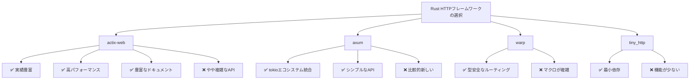
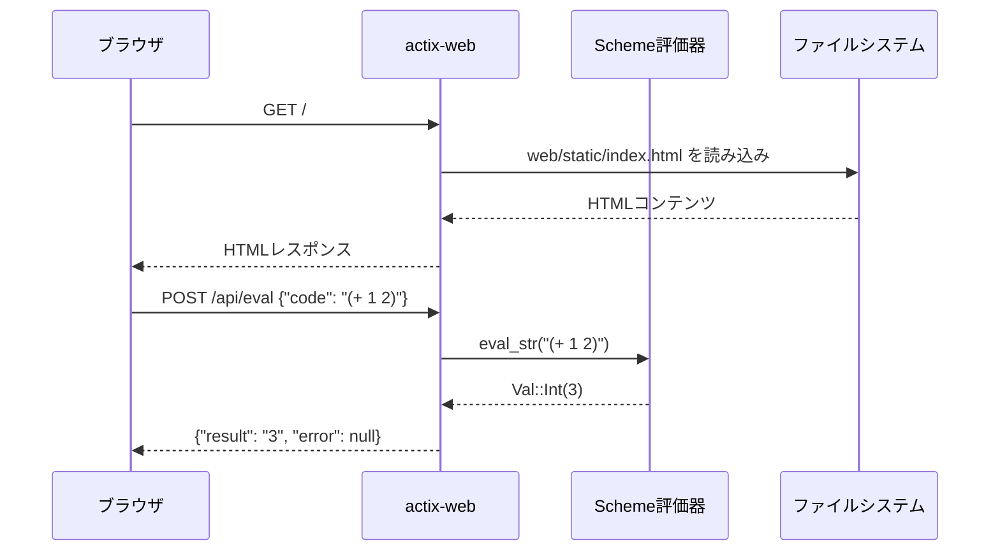

# ADR-004: Web UIにactix-webを採用

**日付:** 2026-02-21
**ステータス:** 承認済み

## 背景

ブラウザベースのREPLを提供するために、Rustで動作するHTTPサーバーフレームワークが必要だった。

## 候補の比較

## 決定

**actix-webを使用する。**

## Web UIのアーキテクチャ

## 理由

- **実績**: crates.io で最もダウンロードされているRust Webフレームワーク
- **パフォーマンス**: TechEmpower ベンチマークでトップクラス
- **機能**: 静的ファイル配信、JSON サポート、ミドルウェアが充実
- **ドキュメント**: 豊富なサンプルと活発なコミュニティ

## 結果

- `actix-web` の `actix_rt` でメインスレッドをブロックせずにサーバーを起動
- セキュリティ: 入力コードは100KB に制限
- 評価はタイムアウトなし（将来の課題）
- Web UI は `--web` フラグでのみ有効になる（通常起動には影響なし）
