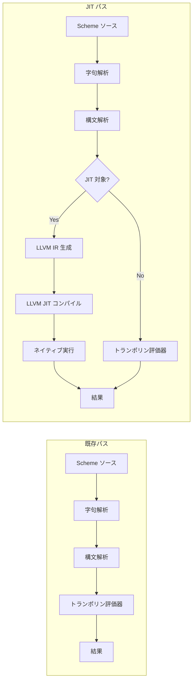
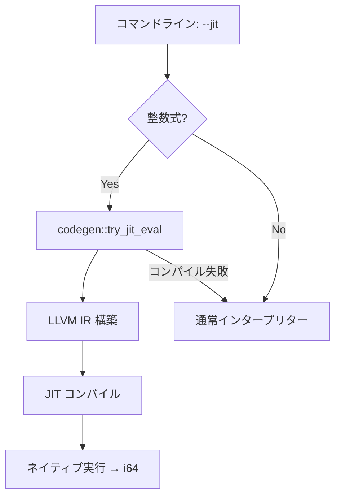

# ADR-005: LLVM 17 JIT バックエンドの採用

## ステータス
採択

## コンテキスト

整数演算などの計算集約型 Scheme コードを高速化するために、LLVM ベースのコンパイルバックエンドの採用が検討された。



## 選択肢

| 選択肢 | メリット | デメリット |
|--------|---------|-----------|
| **inkwell (LLVM 17 Rust バインディング)** | 型安全・Rust 統合・LLVM 最適化利用可能 | コンパイル時間増加・LLVM インストール必須 |
| LLVM C API 直接使用 (`llvm-sys`) | 最大限の制御 | unsafe コード多量・複雑 |
| Cranelift (bytecodealliance) | 軽量・Rust ネイティブ | LLVM ほど最適化が成熟していない |
| WebAssembly バックエンド | ポータビリティ | 実行速度がネイティブより遅い |

## 決定

`inkwell v0.4.0` (`llvm17-0` feature) を **オプションの** Cargo feature (`llvm-backend`) として採用。

### 設計方針



### サポート対象サブセット

LLVM JIT が対応する式:
- 整数・ブールリテラル
- 算術: `+`, `-`, `*`, `quotient`, `remainder`
- 比較: `=`, `<`, `>`, `<=`, `>=`
- 論理: `not`
- 制御: `if`（phi ノードで SSA 形式）、`begin`
- バインディング: `let`、`let*`

### ビルド方法

```sh
# 標準ビルド（LLVM 不要）
cargo build

# LLVM JIT バックエンド付きビルド（LLVM 17 dev 必要）
sudo apt-get install llvm-17-dev libpolly-17-dev
cargo build --features llvm-backend

# JIT モードで実行
sucheme-rust --jit -e "(let ((n 1000)) (* n n))"
# → 1000000

# LLVM IR を出力（デバッグ用）
sucheme-rust --emit-llvm -e "(+ 1 2 3)"
# → LLVM IR (LLVM が定数畳み込みで ret i64 6 に最適化)
```

## 結果

- 標準ビルドは LLVM への依存なし（CI の標準テストは従来通り高速）
- LLVM JIT により整数演算式がネイティブ速度で実行される
- LLVM の最適化パスにより定数式は自動的に定数畳み込みされる
- `SCHEME_DUMP_IR=1` 環境変数で生成 LLVM IR をデバッグ可能
